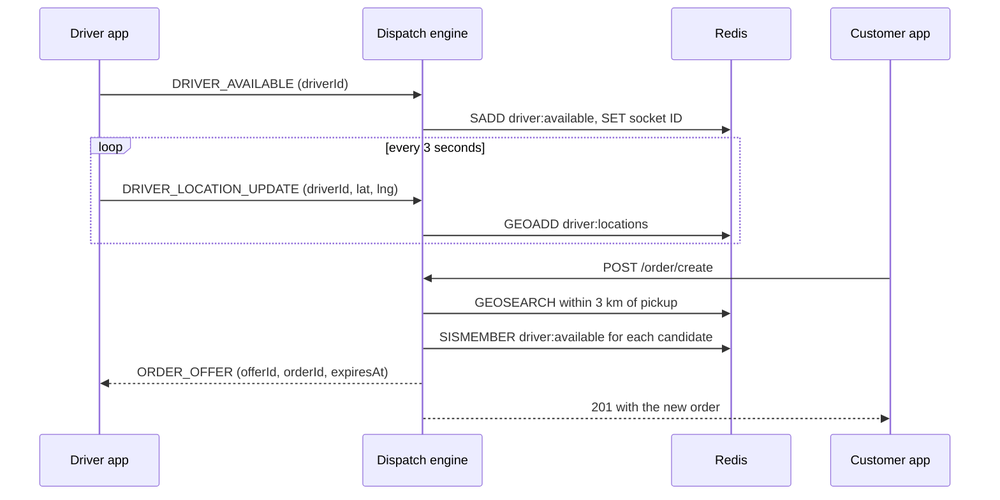

# Dispatch engine

The matching core of a ride-hailing or delivery app. Drivers stream their location over Socket.IO, Redis keeps a live geospatial index of where everyone is, and each new order is offered to the nearest available driver within 3 km of the pickup.

Built with TypeScript, Fastify, Socket.IO and Redis.

## How it works



When an order comes in, the engine searches the location index around the pickup point, keeps only drivers who are still marked available, sorts them by distance and sends the closest one an offer on their own socket. Each offer carries an expiry time 15 seconds out. When a driver disconnects, they are removed from the available set, so they stop receiving offers.

## Redis keys

| Key | Type | Holds |
|---|---|---|
| `driver:locations` | Geo index | The latest position of every driver |
| `driver:available` | Set | IDs of drivers ready to take an order |
| `driver:available:{driverId}` | String | The driver's current socket ID, used to deliver offers |

## API

`POST /order/create`

```json
{
  "userId": "u1",
  "pickup": { "lat": 28.6139, "lng": 77.2090 },
  "dropOff": { "lat": 28.65, "lng": 77.23 }
}
```

Returns `201` with the order:

```json
{
  "orderId": "b30166f4-c2d4-4681-aac0-4004cf384b02",
  "userId": "u1",
  "pickup": { "lat": 28.6139, "lng": 77.209 },
  "dropOff": { "lat": 28.65, "lng": 77.23 },
  "status": "CREATED",
  "assignedDriverId": null
}
```

`GET /health` reports that the service is up.

## Socket.IO events

| Event | Direction | Payload |
|---|---|---|
| `DRIVER_AVAILABLE` | driver to engine | `{ driverId }` |
| `DRIVER_LOCATION_UPDATE` | driver to engine | `{ driverId, lat, lng }` |
| `ORDER_OFFER` | engine to driver | `{ offerId, orderId, expiresAt }` |

## Run it locally

You need Node.js 22 or newer and Redis 6.2 or newer (for `GEOSEARCH`).

```bash
npm install
docker run -d -p 6379:6379 redis:7    # or any Redis you already have
npm run dev                            # engine on http://localhost:3001
```

In a second terminal, start the simulator. It connects 100 drivers spread around central Delhi, each reporting a slightly changed position every 3 seconds:

```bash
npm run simulate
```

In a third terminal, place an order:

```bash
curl -X POST http://localhost:3001/order/create \
  -H "content-type: application/json" \
  -d '{"userId":"u1","pickup":{"lat":28.6139,"lng":77.2090},"dropOff":{"lat":28.65,"lng":77.23}}'
```

The engine logs `Offer <offerId> sent to DRIVER-<n>`, and the simulator prints the offer that driver received. Set `REDIS_URL` (in the environment or a `.env` file) to use a Redis other than `redis://localhost:6379`.

## Project structure

```
src/
  server.ts          Fastify app and Socket.IO handlers
  order/             POST /order/create route, controller and service
  matching/          Nearby-driver search with GEOSEARCH
  driver/            Availability state and filtering
  location/          Location updates with GEOADD
  dispatch/          Sends an offer to a driver's socket
  orderOffer/        Offer records with a 15-second expiry
  redis/             Redis client
  constants/         Redis keys and event names
simulator/
  driver.simulator.ts
```

## What's next

The offer is the last step so far. Next comes handling a driver's accept or reject, marking them busy on accept (`DriverState.markDriverStateBusy` is ready for this), passing the order to the next nearest driver when an offer is declined or expires, and storing orders and offers outside process memory.
